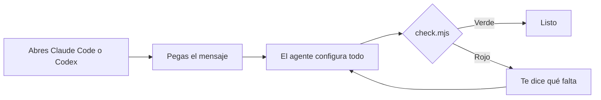

# base-segura

Protege tu proyecto cuando programas con IA: frena paquetes peligrosos, secretos filtrados y versiones viejas.



## Empieza aquí

Abre Claude Code o Codex en la carpeta de tu proyecto y pega este mensaje:

```text
Clona https://github.com/Valinova/base-segura en la versión v0.1.0 en una carpeta temporal, lee su README y configura este proyecto siguiendo "Para el agente".
```

Sirve para un proyecto nuevo o uno que ya existe, aunque nunca hayas usado GitHub.

## Qué te protege

| Riesgo | Protección |
|---|---|
| Paquete malicioso o desconocido | Socket y aprobación de una persona |
| Versión recién publicada | Espera de 48 horas |
| npm sin protección | Solo se permite pnpm |
| Node sin soporte | El check lo bloquea |
| Claves filtradas | Gestor de contraseñas y búsqueda de secretos en GitHub |

## Para el agente

Explica cada paso en una frase y detente cuando se necesite a la persona.

1. **Máquina.** Usa Node vigente (26 si es nuevo). Si falta pnpm: `npm install -g pnpm@12`. Luego corre `pnpm setup`, `pnpm config set --global minimumReleaseAge 2880`, `npm config set min-release-age 2 --location=user` y `pnpm add -g sfw@2.0.6`.
2. **Git.** Si no hay repositorio: `git init`. Si no hay GitHub, ayuda a la persona a crear su cuenta, entrar con `gh auth login` y crear un repositorio **privado**.
3. **Archivos.** Copia al proyecto: `AGENTS.md`, `CLAUDE.md`, `check.mjs`, `pnpm-workspace.yaml`, `referencias.env`, `.claude/settings.json`, `.codex/rules/base-segura.rules`, `.github/dependabot.yml`, `.github/workflows/check.yml`. Agrega `.gitignore` a lo existente y copia `devEngines` y el script `check` a `package.json`. Si un archivo ya existe, combínalo sin perder lo de la persona.
4. **Responsable.** Pregunta quién aprobará los paquetes nuevos y crea `.github/CODEOWNERS` con su usuario de GitHub: `* @usuario`.
5. **Proyecto existente.** Conserva las versiones: `pnpm import`, borra los lockfiles de npm, yarn o bun, y corre `sfw pnpm install`. Mueve los secretos a `referencias.env`; si alguna clave estuvo en git, avisa que hay que cambiarla.
6. **Secretos.** Recomienda 1Password para guardar claves y usar `op run`. Si ya usa otro gestor de contraseñas, sigue con ese.
7. **Revisión.** Corre `node check.mjs`, arregla el rojo con la persona y no debilites ninguna regla. Las actualizaciones grandes se hacen una por una y se prueban.
8. **GitHub.** Guía a la persona para proteger `main`: pull request obligatorio, aprobación del responsable y el check `check` en verde. En Codex, debe marcar el proyecto como confiable para que carguen las reglas.

## Licencia

[MIT](LICENSE)
