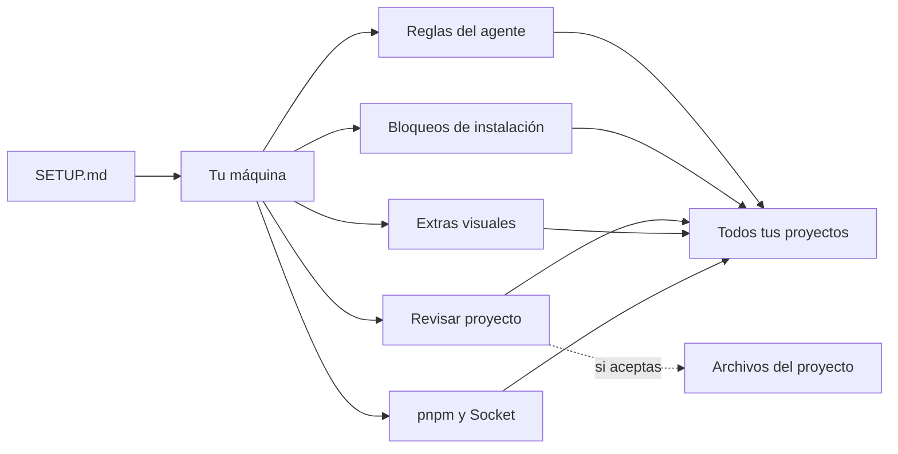
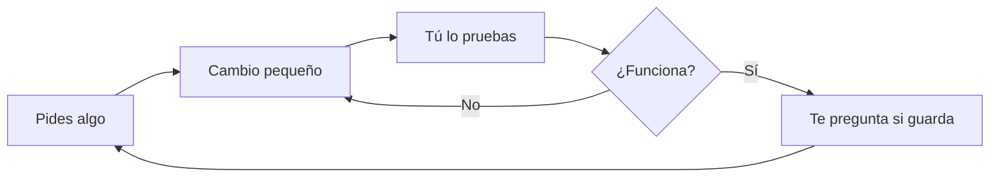

# agentes-listos

Todo lo que tus agentes de IA necesitan para trabajar bien desde el primer día, en todos tus proyectos.

## Empieza aquí

Abre Claude Code o Codex y pega este mensaje:

```text
Clona https://github.com/Valinova/agentes-listos en ~/.agentes-listos (si ya existe, actualízalo) y sigue su SETUP.md.
```

Se hace una sola vez. Para actualizar, pega el mismo mensaje.

## El mapa



| Qué es | En este repo | Dónde queda | Claude Code | Codex |
|---|---|---|---|---|
| 📖 Reglas del agente | [`AGENTS.md`](AGENTS.md) | `~/.claude/CLAUDE.md`, `~/.codex/AGENTS.md` | ✅ | ✅ |
| 🚫 Bloqueos de instalación | [`.claude/settings.json`](.claude/settings.json), [`.codex/rules/`](.codex/rules/agentes-listos.rules) | `~/.claude/settings.json`, `~/.codex/rules/` | ✅ | ✅ |
| 🔍 Revisar proyecto | [`skills/revisar-proyecto/`](skills/revisar-proyecto/SKILL.md) | `~/.claude/skills/`, `~/.codex/skills/` | ✅ | ✅ |
| 📊 Diagramas en el chat | [`mods/diagrams/`](mods/diagrams) | `~/.claude/settings.json` | ✅ | ➖ |
| 🔋 Medidores de uso | [`mods/usage-meters/`](mods/usage-meters) | `~/.claude/settings.json` | ✅ | ➖ |
| 📦 Espera de 48 horas | [`SETUP.md`](SETUP.md) | Configuración global de pnpm y npm | ✅ | ✅ |
| 🧩 Base de un proyecto | [`check.mjs`](check.mjs), [`pnpm-workspace.yaml`](pnpm-workspace.yaml), [`.github/`](.github) | Cada proyecto, si aceptas | ✅ | ✅ |

## Qué cambia



- **Responde en español** y hace solo lo que pediste.
- **Te avisa una vez si ve un riesgo claro**, aunque no le preguntes. Si le dices que ya lo sabes, no insiste.
- **Te puede preguntar si quieres guardar** cuando algo funciona.
- **Te explica cada paquete** antes de instalarlo, usa la versión más nueva con más de 48 horas y lo instala con protección.
- **Cuida tus claves** y comprueba permisos en el servidor.
- **Te muestra diagramas** para explicarte cómo funciona algo, en Claude Code.

## Tu habilidad

Dile **"revisa mi proyecto"** o usa `/revisar-proyecto` en Claude Code. Revisa trabajo sin guardar, paquetes, claves, permisos y código fuera de control. Te da una lista por prioridad y no cambia nada sin tu aprobación. Úsala al empezar con un proyecto y antes de publicar algo importante.

## Cómo pedirle cosas

| En vez de | Prueba con |
|---|---|
| "Arregla el código" | "Los clientes deben poder cancelar su pedido" |
| "Haz toda la app" | Pide una parte, pruébala y sigue |
| "¿Ya funciona?" | Abre la app y pruébala tú |
| Pegar una clave en el chat | Guarda claves de desarrollo en `.env.local`; las de producción, solo en el panel del proveedor |
| Aceptar sin entender | "Explícame eso" o "¿qué riesgo tiene?" |

## Hasta dónde llega

Algunas reglas se aplican solas y otras dependen del agente, y un proyecto puede intentar anularlas. Revisar el proyecto te avisa si eso pasa. Para hacerlo obligatorio en una organización, un administrador debe usar la configuración administrada de Claude y proteger `main` en GitHub. Hazlo en toda app con usuarios o datos reales.

## Licencia

[MIT](LICENSE)
