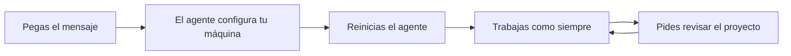

# base-segura

Una configuración base para que tus agentes de IA trabajen bien en todos tus proyectos. Para quien recién empieza y para quien ya construye apps sin ser ingeniero.

## Empieza aquí

Abre Claude Code o Codex y pega este mensaje:

```text
Clona https://github.com/Valinova/base-segura en ~/.base-segura (si ya existe, actualízalo) y sigue su SETUP.md.
```

Se configura una sola vez y aplica a todos tus proyectos. Para actualizar, pega el mismo mensaje.



## Qué cambia

| Tu agente ahora | Por qué |
|---|---|
| Responde en español y hace el cambio más pequeño | Tu código se mantiene entendible |
| Te pregunta si quieres guardar cuando algo funciona | No pierdes tu trabajo |
| Instala paquetes con pnpm y Socket, con 48 horas de espera | Evitas paquetes maliciosos |
| Te explica un paquete antes de agregarlo | Sabes qué entra a tu app |
| No lee tus `.env` y te pide cambiar claves filtradas | Tus secretos no se exponen |
| Comprueba permisos en el servidor | Tus usuarios solo ven lo suyo |

No necesitas conocer estas reglas: están en [AGENTS.md](AGENTS.md) y el agente las sigue.

## Tu habilidad: revisar el proyecto

Dile **"revisa mi proyecto"** o usa `/revisar-proyecto` en Claude Code. Solo mira y te da una lista por prioridad: trabajo sin guardar, reglas anuladas, claves expuestas y permisos. No cambia nada sin tu aprobación, y puede dejar el proyecto preparado.

Hazlo al empezar a usar un proyecto y antes de publicar algo importante.

## Cómo pedirle cosas

- **Describe el resultado**, no el código: "los clientes deben poder cancelar su pedido".
- **Pide algo pequeño** y pruébalo antes de seguir.
- **Abre la app tú mismo.** Que el agente diga "listo" no significa que funcione.
- **Pregunta sin miedo:** "explícame eso" o "¿qué riesgo tiene?".
- **Nunca pegues claves en el chat.** Si pasó, cámbialas.
- **Guarda seguido:** cuando pregunte si quieres hacer commit, normalmente di que sí.

## Qué tan protegido estás

Las reglas guían al agente; algunas se aplican solas y otras dependen de él. Para que sea obligatorio en una organización, un administrador debe aplicarlo con la configuración administrada de Claude y protegiendo `main` en GitHub. Hazlo en toda app con usuarios o datos reales.

## Licencia

[MIT](LICENSE)
